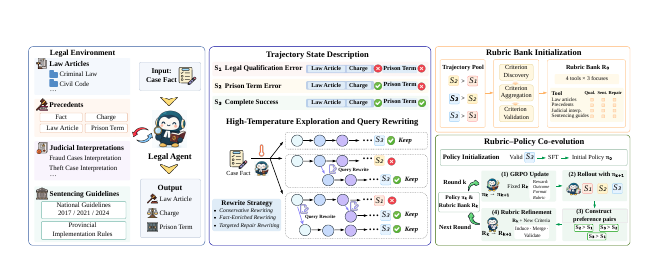
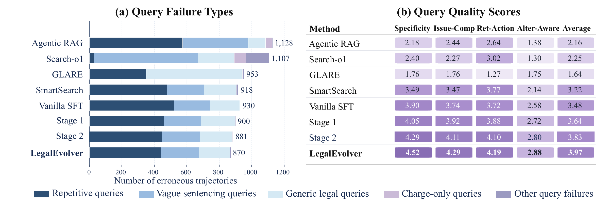
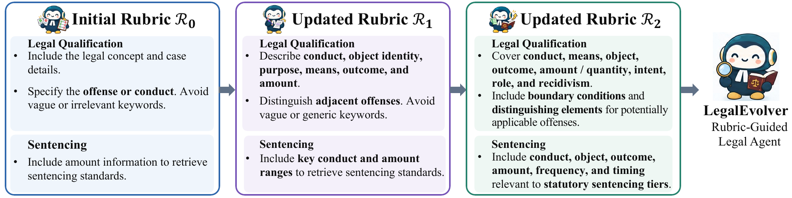

<div align="center">

# ⚖️ LegalEvolver

### Agentic Legal Judgment Prediction via Rubric-Guided Self-Evolution

**Better legal searches. Evidence-grounded reasoning. Structured judgment prediction.**

Xinyu Yang · Jiejun Tan · Chenlong Deng · Chenghao Zhang · Tongyu Wen · Zhicheng Dou<br>
Renmin University of China

[](https://huggingface.co/yxy919/LegalEvolver-Qwen3-8B) [](https://github.com/yxy-919/LegalEvolver) [](https://github.com/yxy-919/LegalEvolver/releases/tag/checkpoint-best-v1)

[Overview](#overview) · [Results](#results) · [Quick Start](#quick-start) · [Prediction](#prediction) · [Evaluation](#evaluation) · [Retrieval Tools](#retrieval-tools) · [Citation](#citation)

</div>

<p align="center"></p>
<p align="center"><sub>The LegalEvolver framework. This release provides the checkpoint, legal retrieval tools, inference runner and evaluation scripts.</sub></p>

## News

- **2026-11-02** — Released the inference-ready **LegalEvolver-Qwen3-8B** checkpoint, four legal retrieval tools, and single-/multi-defendant inference and evaluation code.

## Overview

Legal Judgment Prediction (LJP) requires models to conduct multi-step reasoning and external legal evidence retrieval. Existing legal search agents' performance is often constrained by the quality of retrieval queries. They often formulate queries directly from the initial user request, overlooking latent legal issues and legally salient details.

To address these challenges, we propose LegalEvolver, a framework for training legal search agents. It learns query rubrics from the agent's own trajectories and keeps refreshing them as the agent improves. Training consists of three consecutive stages.

**(1) Diverse Trajectory Generation and Policy Initialization.** We first sample diverse reasoning and retrieval trajectories at a high temperature, then apply expert-inspired heuristics to rewrite their retrieval queries, producing additional candidate trajectories. Rejection sampling selects successful trajectories for supervised fine-tuning, equipping the agent with effective initial reasoning and retrieval behaviors.

**(2) Initial Rubric Construction.** To construct query-level supervision, we contrast successful trajectories with failed trajectories for the same problem, examining how differences in query construction contribute to their divergent outcomes. We distill these comparisons into an initial set of legal query rubrics that provide explicit criteria for evaluating intermediate queries.

**(3) Rubric–Policy Co-Evolution.** Building on this initialization, we jointly improve the query rubrics and the agent policy through iterative self-evolution. We combine rubric-based rewards with outcome rewards for reinforcement learning, providing feedback on both intermediate query quality and final prediction correctness. As the updated policy generates new successful trajectories, we use them to re-induce the rubrics, incorporating retrieval strategies discovered during training. The revised rubrics then guide the next round of policy optimization. Alternating these steps lets supervision evolve with the agent's capabilities, enabling improvement beyond the initial demonstrations and fixed rubric criteria.

## Results

### Main judgment prediction results

Selected Qwen3-8B comparisons from manuscript **Table 1**. Each cell is **Accuracy / Macro-F1 (%)**; higher is better.

| Dataset | Method | Law Article | Charge | Prison Term |
|:---|:---|:---:|:---:|:---:|
| CAIL2018 | Agentic RAG | 62.9 / 44.8 | 58.2 / 35.3 | 10.2 / 8.2 |
| CAIL2018 | Vanilla SFT | 79.9 / 70.0 | 76.6 / 68.5 | 20.0 / 20.5 |
| CAIL2018 | Standard GRPO | 80.7 / 68.9 | 78.2 / 69.4 | 21.2 / 20.8 |
| CAIL2018 | SmartSearch | 81.1 / 67.3 | 78.3 / 69.5 | 20.7 / 20.7 |
| CAIL2018 | **LegalEvolver** | **82.1 / 70.7** | **79.4 / 71.9** | **22.1 / 21.0** |
| CMDL | Agentic RAG | 72.2 / 80.1 | 75.9 / 79.7 | 7.9 / 7.0 |
| CMDL | Vanilla SFT | 80.6 / 82.7 | 79.6 / 80.2 | 23.6 / 19.7 |
| CMDL | Standard GRPO | 84.2 / 85.2 | 82.1 / 83.8 | 24.0 / 20.7 |
| CMDL | SmartSearch | 85.2 / 87.3 | 82.3 / 84.0 | 25.5 / 22.6 |
| CMDL | **LegalEvolver** | **85.7 / 87.6** | **84.4 / 85.1** | **25.6 / 22.8** |

**Overall: 61.5**, compared with 60.4 for SmartSearch and 59.9 for Standard GRPO. Overall is the unweighted mean of the 12 task/dataset metrics. The manuscript evaluates balanced test subsets of **1,000 CAIL2018 cases** and **2,000 CMDL cases**.


<details>
<summary><b>Query quality and rubric evolution in the paper</b></summary>

The paper examines legal specificity, legal-issue completeness, retrieval actionability and alternative awareness. It reports an average query-quality score of **3.97** for LegalEvolver, compared with **3.22** for SmartSearch and **2.16** for Agentic RAG.

<p align="center"></p>

The statute-search example below shows criteria becoming more explicit about decisive facts, offense boundaries and statutory sentencing tiers. These figures summarize the paper's query analysis and rubric design.

<p align="center"></p>

</details>

## Quick Start

Run commands from the repository root. vLLM serving requires a compatible GPU environment; retrieval defaults to CPU.

### 1. Install

```bash
git clone https://github.com/yxy-919/LegalEvolver.git
cd LegalEvolver
python -m venv .venv
source .venv/bin/activate
pip install -e .
pip install huggingface_hub
# Install a vLLM build compatible with your CUDA/PyTorch environment.
pip install vllm
```

Python **3.10+** is required. The default server uses **2 GPUs**; adjust tensor parallelism and context length to fit your hardware. Weights occupy about **16.4 GB**; GPU memory also needs to accommodate the KV cache and runtime overhead.

### 2. Download the checkpoint

```bash
hf download yxy919/LegalEvolver-Qwen3-8B \
  --local-dir checkpoints/LegalEvolver-Qwen3-8B
```

Or use Python:

```python
from huggingface_hub import snapshot_download

model_path = snapshot_download(
    repo_id="yxy919/LegalEvolver-Qwen3-8B",
    local_dir="checkpoints/LegalEvolver-Qwen3-8B",
)
print(model_path)
```

The model contains four original safetensors shards, their index, tokenizer and configuration files. No manual archive concatenation is needed. The [GitHub Release](https://github.com/yxy-919/LegalEvolver/releases/tag/checkpoint-best-v1) remains a backup, downloadable with `bash checkpoints/download.sh`.

### 3. Start the model server

```bash
TENSOR_PARALLEL_SIZE=2 bash Eval/inference/serve.sh \
  checkpoints/LegalEvolver-Qwen3-8B

# In another terminal, check the endpoint:
curl http://127.0.0.1:8000/v1/models
```

The served model name is **`LegalEvolver`**. The script binds to localhost:8000 with a 40,960-token context. To change these settings:

```bash
PORT=8001 TENSOR_PARALLEL_SIZE=1 MAX_MODEL_LEN=20480 \
  bash Eval/inference/serve.sh checkpoints/LegalEvolver-Qwen3-8B
```

The server generates the next response. **`run_agentic.py` executes retrieval calls and feeds observations back to the model**; a bare chat-completions request does not execute the legal tools automatically.

### 4. Configure retrieval resources

Download the complete FAISS indexes, aligned metadata, and sentencing context from the [retrieval data release](https://github.com/yxy-919/LegalEvolver/releases/tag/retrieval-data-v1). The download script verifies the archive before extraction.

```bash
pip install huggingface_hub
hf download CSHaitao/SAILER_zh --local-dir checkpoints/SAILER_zh
bash Retrieval/download_full_data.sh
export SAILER_MODEL_PATH="$PWD/checkpoints/SAILER_zh"
export LEGAL_INDEX_ROOT="$PWD/data/retrieval-full/indexes"
export SENTENCING_CONTEXT_PATH="$PWD/data/retrieval-full/sentencing_general_context.jsonl"
```

See the [Retrieval Resource Guide](docs/retrieval.md) for the file layout and standalone tool interface. The complete data includes national and available provincial guideline indexes.

## Prediction

### Predict one case

Create a JSONL input. Here is a usage example:

```bash
mkdir -p data
cat > data/example_single.jsonl <<'JSONL'
{"caseID":"demo-single-001","fact":"被告人甲趁乙不备，秘密取走乙放在桌上的手机，后被查获。","meta":{"criminals":["甲"]}}
JSONL

python -m Eval.inference.run_agentic \
  --test_dataset_path data/example_single.jsonl --dataset_type single \
  --output_dir outputs/demo-single --model_name LegalEvolver \
  --base_urls http://127.0.0.1:8000/v1
```

### Predict a dataset

```bash
# Single defendant
python -m Eval.inference.run_agentic \
  --test_dataset_path data/cail_test.jsonl --dataset_type single \
  --output_dir outputs/cail --model_name LegalEvolver \
  --base_urls http://127.0.0.1:8000/v1

# Multiple defendants
python -m Eval.inference.run_agentic \
  --test_dataset_path data/cmdl_test.jsonl --dataset_type multi \
  --output_dir outputs/cmdl --model_name LegalEvolver \
  --base_urls http://127.0.0.1:8000/v1
```

| Input field | Single defendant | Multiple defendants |
|:---|:---|:---|
| `caseID` | Unique case identifier | Unique case identifier |
| `fact` | Case fact description | Case fact description |
| Defendant names | `meta.criminals`: list of names | `defendants`: list of names |
| Gold judgments | Not required for prediction | Not required with `--dataset_type multi` |

Use `--dataset_type multi` explicitly for unlabeled multi-defendant inputs. Ground-truth outcomes are not inserted into the inference prompt.

### Read the output

Each row in `outputs/<run>/predictions.jsonl` includes `caseID`, `sample_idx`, `dataset_type`, `predict` (trace and final answer) and `tool_call` records. Final answers use `<answer>...</answer>` with JSON inside. Prison terms are **class IDs 0–10**, not months; [`prompts.py`](Eval/inference/prompts.py) defines the categories.

```python
import json
from Eval.inference.run_agentic import extract_between

with open("outputs/demo-single/predictions.jsonl", encoding="utf-8") as f:
    row = json.loads(next(f))
answer = extract_between(row["predict"], "<answer>", "</answer>")
if answer is None:
    raise ValueError("No final answer found; inspect the saved trace.")
print(json.dumps(json.loads(answer), ensure_ascii=False, indent=2))
```

Single-defendant answers contain `relevant_articles`, `accusation` and `sentence_interval`. Multi-defendant answers contain `defendants`, each with `name` and `judgments`, using those three prediction fields per judgment.

### Generation controls

| Argument | Default | Purpose |
|:---|:---:|:---|
| `--max_turn` | 10 | Retrieval-call budget |
| `--retrieval_top_k` | 3 | Hits per call in the historical runner |
| `--max_tokens` | 8192 | Generated tokens per model request |
| `--temperature` / `--top_p` | 0.6 / 0.95 | Sampling settings |
| `--top_k_sampling` / `--min_p` | 20 / 0 | Additional sampling settings |
| `--concurrent_limit` | 8 | Concurrent model requests |
| `--concurrent_limit_tool` | 1 | Concurrent retrieval calls |
| `--samples_per_case` | 1 | Samples per input case |


## Evaluation

Use labeled gold JSONL in the **original CAIL2018/CMDL schema** and the runner's prediction JSONL. The prediction-only example above lacks the labels needed for scoring. See [Evaluation Input Formats](docs/evaluation.md) for synthetic schema examples and the gold/prediction field mapping.

```bash
# Optional: original semantic fallback for charge normalization.
export BGE_MODEL_PATH=/path/to/BAAI_bge-m3

# Single defendant
python -m Eval.new_eval_single_defendant \
  --gold_path data/cail_test.jsonl \
  --pred_path outputs/cail/predictions.jsonl \
  --output_path outputs/cail/metrics.json --include_summary

# Multiple defendants
python -m Eval.eval_multi_defendant \
  --gold_path data/cmdl_test.jsonl \
  --pred_path outputs/cmdl/predictions.jsonl \
  --output_path outputs/cmdl/metrics.json --include_summary
```

Both scripts report law-article, charge and prison-term metrics. Single-defendant scoring preserves the original first-label article/charge convention. Multi-defendant scoring aligns predictions **by defendant name**, retaining the original set metrics and case/defendant weighting.

Charge vocabularies, aliases and precomputed embeddings are in [`Eval/data/`](Eval/data/). Supply the BGE encoder separately for the original semantic normalization fallback; without it, some charge mappings can differ.

## Retrieval Tools

| Tool | Evidence | Typical question |
|:---|:---|:---|
| `statute_search` | Criminal-law articles and statutory text | Which statutory elements and provisions apply? |
| `case_search` | Similar facts, articles, charges and sentencing information | How were comparable circumstances judged? |
| `judicial_interpretation_search` | Clause-level judicial interpretations | How are legal elements, thresholds or boundaries interpreted? |
| `guideline_search` | National guidelines and optional provincial indexes | Which sentencing ranges and adjustment factors are relevant? |

The release uses a shared **SAILER encoder + FAISS dense search**, returning **evidence cards** with source identifiers, text, scores and metadata. Guideline retrieval retains version filtering and optional provincial-index handling. The paper environment describes 491 statutory articles, 7,214 interpretation clauses and 64 national guideline sections; the complete retrieval indexes and metadata are available in the retrieval data release.

```python
from Retrieval.tool_manager import ToolManager

tools = ToolManager(topk_default=4, topk_max=4)
result = tools.call_tool(
    "statute_search",
    {"query": "借用手机后逃离 盗窃与诈骗 财物处分意思", "topk": 4},
)
for card in result.get("results", []):
    print(card["title"], card["text"])
```

The tools also work independently of the model. See [the retrieval guide](docs/retrieval.md) for resource configuration and the boundary between the paper environment and this inference release.

## Repository Map

```text
Retrieval/                 Legal tools, SAILER encoder and FAISS helpers
Eval/
  inference/               Multi-turn runner, prompts and vLLM serving
  new_eval_single_defendant.py
  eval_multi_defendant.py
  common.py                Parsing, normalization and metrics
  data/                    Charge vocabularies, aliases and embeddings
checkpoints/               Download helper, checksums and recorded metrics
assets/                    Manuscript figures
docs/                      Retrieval guide and reproduction notes
```

Inference lives in `Eval/inference/`, scoring in `Eval/`, using one directory spelling for case-insensitive filesystem compatibility.

## Citation

If you use this work, please cite the manuscript:

```bibtex
@misc{yang2026legalevolver,
  title  = {LegalEvolver: Agentic Legal Judgment Prediction via Rubric-Guided Self-Evolution},
  author = {Xinyu Yang and Jiejun Tan and Chenlong Deng and Chenghao Zhang and Tongyu Wen and Zhicheng Dou},
  year   = {2026},
  note   = {Research manuscript},
  url    = {https://github.com/yxy-919/LegalEvolver}
}
```

**Contact:** [yxygsai@ruc.edu.cn](mailto:yxygsai@ruc.edu.cn) · [dou@ruc.edu.cn](mailto:dou@ruc.edu.cn)
